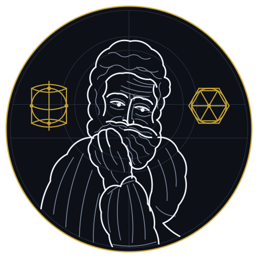

:site_title: Archimedes of Syracuse

.. container:: author-overline

   semantic digital archive • the works of

======================
Archimedes of Syracuse
======================

:person:`Archimedes of Syracuse <archimedes>` (c. 287–212 BCE) united geometry, mechanics, and infinitesimal reasoning to measure the circle, square the parabola, balance centers of gravity, and discover the surface area and volume of the sphere. This archive brings together his surviving treatises—from the *Measurement of a Circle* and *On the Equilibrium of Planes* to the Constantinople Palimpsest *Method*—in Sir Thomas L. Heath's critical English editions, paired with calibrated vector diagrams and a full Heiberg–Heath concordance.

Works in This Archive
---------------------

.. container:: home-book-hero

   .. container:: home-book-thumb

      .. image:: _static/figures/fig_circle_96gon.svg
         :alt: Inscribed and circumscribed 96-gons bounding pi
         :target: measurement_of_a_circle/index.html

   .. container:: home-book-body

      .. rubric:: Heiberg I & Heath 1897 · 3 Propositions

      **Measurement of a Circle (*Dimensio Circuli*)** — Proves by double exhaustion that a circle equals the right triangle on its circumference and radius, and bounds :math:`\pi` between :math:`3\frac{10}{71}` and :math:`3\frac{1}{7}` using inscribed and circumscribed 96-gons.

      .. container:: home-actions

         * :doc:`Open Measurement of a Circle → <measurement_of_a_circle/index>`
         * :doc:`Proposition 1 → <measurement_of_a_circle/prop_01>`
         * :doc:`96-Gon Bounds (Prop. 3) → <measurement_of_a_circle/prop_03>`

.. container:: home-book-hero

   .. container:: home-book-thumb

      .. image:: _static/figures/fig_parabola_exhaustion.svg
         :alt: Exhaustion of a parabolic segment by inscribed triangles
         :target: quadrature_of_the_parabola/index.html

   .. container:: home-book-body

      .. rubric:: Heiberg II & Heath 1897 · Epistle · 24 Propositions

      **Quadrature of the Parabola (*Quadratura Parabolae*)** — Establishes that the area of a parabolic segment is four-thirds of its inscribed triangle, proved first by mechanical balance and then by pure geometric exhaustion using the infinite series :math:`1 + \frac{1}{4} + \frac{1}{16} + \cdots`.

      .. container:: home-actions

         * :doc:`Open Quadrature of the Parabola → <quadrature_of_the_parabola/index>`
         * :doc:`Read the Epistle → <quadrature_of_the_parabola/epistle>`
         * :doc:`Geometric Exhaustion (Prop. 24) → <quadrature_of_the_parabola/prop_24>`

.. container:: home-book-hero

   .. container:: home-book-thumb

      .. image:: _static/figures/fig_triangle_centroid.svg
         :alt: Center of gravity of a triangle
         :target: equilibrium_of_planes/index.html

   .. container:: home-book-body

      .. rubric:: Heiberg II & Heath 1897 · 2 Books · 25 Propositions

      **On the Equilibrium of Planes (*De Planorum Aequilibriis*)** — Grounds theoretical statics in seven postulates, proves the Law of the Lever for commensurable and incommensurable magnitudes, and locates the centers of gravity of triangles, parallelograms, and parabolic segments.

      .. container:: home-actions

         * :doc:`Open Equilibrium of Planes → <equilibrium_of_planes/index>`
         * :doc:`Read the Postulates → <equilibrium_of_planes/postulates>`
         * :doc:`Triangle Centroid (I.13) → <equilibrium_of_planes/prop_13>`

.. container:: home-book-hero

   .. container:: home-book-thumb

      .. image:: _static/figures/fig_sphere_cylinder.svg
         :alt: Sphere inscribed in a cylinder demonstrating the 2:3 ratio
         :target: sphere_and_spirals/index.html

   .. container:: home-book-body

      .. rubric:: Heiberg I–II & Heath 1897 · 4 Treatises

      **Sphere and Cylinder, Spirals & Conoids** — Unites Archimedes' grand Dositheus treatises: the surface and volume of the sphere (the 2:3 *Tomb Theorem*), tangent rectification and quadrature of the Archimedean spiral, and cubatures of paraboloids, hyperboloids, and spheroids.

      .. container:: home-actions

         * :doc:`Open Sphere & Spirals → <sphere_and_spirals/index>`
         * :doc:`Sphere & Cylinder I → <sphere_and_spirals/sphere_cylinder_i>`
         * :doc:`On Spirals → <sphere_and_spirals/on_spirals>`

.. container:: home-book-hero

   .. container:: home-book-thumb

      .. image:: _static/figures/fig_method_lever.svg
         :alt: Mechanical slice balancing in The Method
         :target: the_method/index.html

   .. container:: home-book-body

      .. rubric:: Constantinople Palimpsest · Heiberg 1907 · Heath 1912 · 15 Propositions

      **The Method of Mechanical Theorems** — Deciphered by J. L. Heiberg from the erased Constantinople Palimpsest, revealing Archimedes' private letter to Eratosthenes on how slicing solids into indivisible lines and weighing them on an imaginary lever led to his greatest discoveries.

      .. container:: home-actions

         * :doc:`Open The Method → <the_method/index>`
         * :doc:`Letter to Eratosthenes → <the_method/epistle>`
         * :doc:`Parabola by Weighing (Prop. 1) → <the_method/prop_01>`

.. container:: home-book-hero

   .. container:: home-book-thumb

      .. image:: _static/figures/fig_arbelos_twins.svg
         :alt: The Arbelos and Archimedes' Twin Circles
         :target: book_of_lemmas/index.html

   .. container:: home-book-body

      .. rubric:: Liber Assumptorum · Thābit ibn Qurra · Heath 1897 · 15 Propositions

      **Book of Lemmas (*Kitāb al-Maʾkhūdhāt*)** — Fifteen planar geometric gems preserved in Arabic by Thābit ibn Qurra, including the shoemaker's knife (*Arbelos*), Archimedes' Twin Circles, the *Salinon*, neusis angle trisection, and a golden-section construction.

      .. container:: home-actions

         * :doc:`Open Book of Lemmas → <book_of_lemmas/index>`
         * :doc:`The Arbelos (Prop. 4) → <book_of_lemmas/prop_04>`
         * :doc:`The Salinon (Prop. 14) → <book_of_lemmas/prop_14>`

.. container:: home-book-hero

   .. container:: home-book-thumb

      .. image:: _static/figures/fig_semi_regular_solids.svg
         :alt: Semi-regular Archimedean solids diagram
         :target: arenarius/index.html

   .. container:: home-book-body

      .. rubric:: Heiberg II · Pappus V.19 · Heath 1897

      **The Sand-Reckoner & Semi-Regular Solids** — Preserves Aristarchus's heliocentric universe and Archimedes' myriad-octad number system for counting grains of sand, paired with the 14-piece *Stomachion* square puzzle and Pappus's census of the thirteen Archimedean polyhedra.

      .. container:: home-actions

         * :doc:`Open The Sand-Reckoner → <arenarius/index>`
         * :doc:`Read Arenarius → <arenarius/sand_reckoner>`
         * :doc:`13 Semi-Regular Solids → <arenarius/semi_regular_solids>`

Key Features
------------

.. container:: home-feature-grid

   .. container:: home-feature-card

      **11 Interactive Geometric Plates**

      Calibrated vector diagrams trace every construction—from the 96-gon bounds on :math:`\pi` and parabolic exhaustion to the Archimedean spiral, *Arbelos*, *Salinon*, and Palimpsest lever.

   .. container:: home-feature-card

      **Heiberg–Heath–Palimpsest Concordance**

      Cross-reference every theorem across Heiberg's critical Greek volumes, Heath's 1897 *Works*, the 1912 *Method* Supplement, and Eutocius's commentaries in the :doc:`Concordance <concordance>`.

   .. container:: home-feature-card

      **Synchronized Summary & Notes Tracks**

      Each treatise pairs Heath's faithful English text with an editorial **Summary** track and archival **Notes** track detailing manuscript witnesses and mathematical structure.

Reference & Project
-------------------

.. container:: home-columns

   .. container:: home-col

      .. rubric:: Scholarly Apparatus

      * :doc:`People <people/index>` — Archimedes, Dositheus, Eratosthenes, Eutocius, Thābit ibn Qurra, Heiberg, and Heath
      * :doc:`Concordance <concordance>` & :doc:`Bibliography <bibliography>` — Proposition numbering across editions and critical sources
      * :doc:`Glossary <glossary>` — Key Doric Greek, mechanical, and geometric terms

   .. container:: home-col

      .. rubric:: About This Project

      * :doc:`About <about/index>` — Scope, sources, and editorial methodology
      * :doc:`Using This Edition <usage/index>` — Reading guide, track switching, and diagram controls
      * :doc:`Log <log/index>` & :doc:`Modules <modules/index>` — Development notes and Python package reference

.. toctree::
   :hidden:
   :maxdepth: 2

   measurement_of_a_circle/index
   quadrature_of_the_parabola/index
   equilibrium_of_planes/index
   sphere_and_spirals/index
   the_method/index
   book_of_lemmas/index
   arenarius/index
   people/index
   bibliography
   concordance
   glossary
   usage/index
   about/index
   modules/index
   log/index

